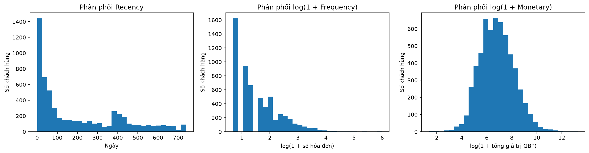
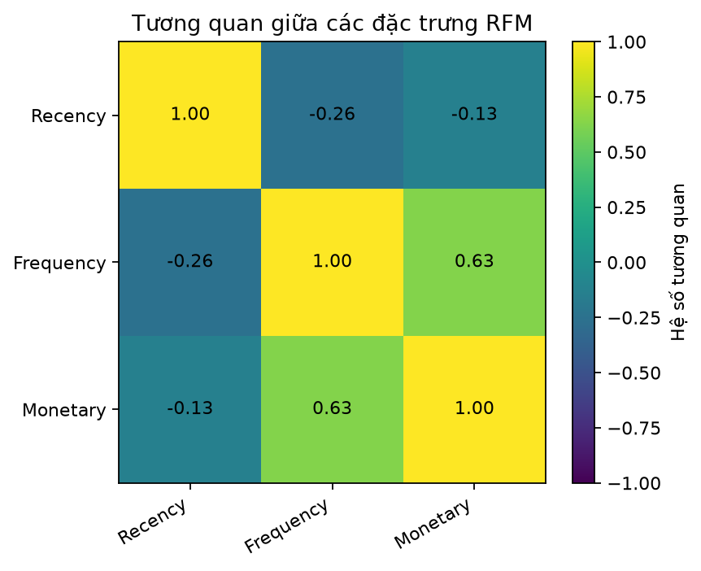

# Chương 3. Dữ liệu, khám phá và tiền xử lý

> Rà soát số liệu và nguồn: 18/11/2026. Đây là phần Chương 3 do TV1 phụ trách; kết quả EXP-037 toàn bộ khách hàng sẽ được bổ sung khi TV3 bàn giao.


## 3.1. Nguồn và phạm vi dữ liệu

Đồ án sử dụng Online Retail II do Daqing Chen cung cấp cho UCI Machine Learning Repository. Bộ dữ liệu ghi nhận giao dịch của nhà bán lẻ trực tuyến tại Vương quốc Anh từ 01/12/2009 đến 09/12/2011, gồm 1.067.371 dòng giao dịch và 8 trường. Nguồn và giấy phép CC BY 4.0 được ghi ở cuối chương [1]. Tệp `data/raw/online_retail_II.xlsx` hiện có trên máy; quy tắc `.gitignore` loại dữ liệu gốc khỏi Git.

Các trường gốc gồm `InvoiceNo`, `StockCode`, `Description`, `Quantity`, `InvoiceDate`, `UnitPrice`, `CustomerID` và `Country`. Đơn vị quan sát của phân tích RFM và phân cụm là khách hàng. `CustomerID` dùng để nhận diện, đếm và ghép kết quả; không đưa vào khoảng cách của mô hình.

## 3.2. Khám phá và làm sạch dữ liệu

Các bước làm sạch được áp dụng tuần tự:

| Bước | Dòng bị loại | Dòng còn lại |
|---|---:|---:|
| Dữ liệu gốc | 0 | 1.067.371 |
| Loại bản ghi trùng hoàn toàn | 34.335 | 1.033.036 |
| Loại dòng thiếu `CustomerID` | 235.151 | 797.885 |
| Loại hóa đơn hủy có mã bắt đầu bằng `C` | 18.390 | 779.495 |
| Loại `Quantity <= 0`, `UnitPrice <= 0` hoặc ngày không hợp lệ | 70 | 779.425 |

*Bảng 3.1. Số dòng qua các bước làm sạch. Nguồn: `outputs/tables/preprocessing_summary.csv`.*

Sau làm sạch còn 779.425 dòng giao dịch, 36.969 hóa đơn và 5.878 khách hàng. Thời gian giao dịch hợp lệ trải từ 01/12/2009 07:45 đến 09/12/2011 12:50. Tổng doanh thu của dữ liệu sạch là £17.374.804,268 (`outputs/tables/eda_summary.csv`).

## 3.2.1. Khám phá phân phối RFM



*Hình 3.1. Phân phối Recency, Frequency và Monetary. Nguồn: tính từ bảng RFM của đồ án.*



*Hình 3.2. Tương quan giữa ba biến RFM. Nguồn: tính từ bảng RFM của đồ án.*

## 3.3. Tạo đặc trưng RFM

Mỗi dòng trong `outputs/tables/rfm_table.csv` đại diện cho một khách hàng. Ngày tham chiếu là 10/12/2011, tức ngày sau ngày giao dịch cuối cùng.

| Đặc trưng | Định nghĩa |
|---|---|
| Recency | Số ngày từ lần mua gần nhất đến ngày tham chiếu; giá trị nhỏ hơn thể hiện lần mua gần hơn. |
| Frequency | Số hóa đơn khác nhau của khách trong giai đoạn dữ liệu. |
| Monetary | Tổng `Quantity × UnitPrice` của khách, đơn vị GBP. |

*Bảng 3.2. Định nghĩa đặc trưng RFM. Nguồn: quy tắc tính trong Notebook 01.*

Bảng RFM hiện có 5.878 dòng và mã khách duy nhất. Các kiểm tra trong `outputs/tables/rfm_validation_report.csv` đều PASS: không thiếu hoặc trùng mã khách; giá trị số hữu hạn; RFM không âm; Frequency là số nguyên dương; Monetary dương.

| Đặc trưng | Trung vị | Trung bình |
|---|---:|---:|
| Recency (ngày) | 96 | 201,87 |
| Frequency (hóa đơn) | 3 | 6,29 |
| Monetary (GBP) | 867,74 | 2.955,90 |

*Bảng 3.3. Thống kê mô tả RFM, tính trên 5.878 dòng trong `outputs/tables/rfm_table.csv`.*

Frequency và Monetary có phân phối lệch phải. Pipeline phân cụm áp dụng `log1p` lên ba biến RFM, sau đó chuẩn hóa trước khi tính khoảng cách.

## 3.4. Đầu vào và quy tắc chọn mô hình

Đầu vào mô hình gồm `Recency`, `Frequency`, `Monetary`; `CustomerID` chỉ phục vụ đối chiếu. Các thí nghiệm hiện lưu dùng mẫu cố định 2.000 khách hàng, lấy không hoàn lại với seed 42. Quy tắc chọn là ưu tiên Silhouette cao nhất trong các cấu hình có 2–8 cụm và tỷ lệ nhiễu không quá 20%.

Kết quả đang được chọn là K-Means k=2, `init=k-means++`, `n_init=20`, `random_state=42`, tiền xử lý `log1p` và RobustScaler. Silhouette đạt 0,430303; Davies–Bouldin đạt 0,875147; Calinski–Harabasz đạt 1.058,491; tỷ lệ nhiễu bằng 0%.

| Scaler, k=2 | Silhouette | Davies–Bouldin | Calinski–Harabasz | ARI giữa hai scaler |
|---|---:|---:|---:|---:|
| StandardScaler | 0,424588 | 0,897555 | 1.019,488 | 0,868438 |
| RobustScaler | 0,430303 | 0,875147 | 1.058,491 | 0,868438 |

*Bảng 3.4. So sánh scaler ở cùng mẫu, k và seed. Nguồn: `outputs/tables/exp035_scaling_comparison.csv`; metric tính trên cùng 1.000 khách đánh giá.*

EXP-035 kiểm tra điều kiện so sánh và ghi PASS cho k=2,3: cùng 2.000 ID, cùng đặc trưng, seed và số lần khởi tạo; chỉ thay scaler. Với RobustScaler, phương sai sau chuẩn hóa của Recency/Frequency/Monetary lần lượt là 0,331/0,352/0,535; Frequency không có phương sai lớn nhất. Với StandardScaler, phương sai của cả ba biến bằng xấp xỉ 1.

EXP-034 có ARI nhỏ nhất giữa năm seed bằng 0,974137; độ dao động silhouette là 0,297894–0,300278. Kết quả ổn định cao trên mẫu này, nhưng không chứng minh ổn định ngoài mẫu. EXP-036 có 9 cấu hình DBSCAN chỉ tạo một cụm ngoài nhiễu; các metric không xác định được giữ trống, không thay bằng 0.

Các chỉ số này được tính trong thí nghiệm trên mẫu: mô hình được fit với 2.000 khách, các metric EXP-035/036 được đánh giá trên 1.000 khách dùng chung. Vì vậy, không diễn giải chúng như hiệu năng đã xác nhận trên toàn bộ 5.878 khách.

## 3.5. Giới hạn và phần cần hoàn tất

Hiện `outputs/tables/selected_model_customer_labels.csv` có nhãn cho mẫu 2.000 khách. Đã đối chiếu mẫu trước/sau: 2.000 ID duy nhất khớp; hồ sơ cụm cộng 2.000. Chưa có `outputs/tables/customer_clusters_full.csv` và `outputs/tables/final_cluster_profiles.csv` của EXP-037, nên chưa thể kết luận số khách từng cụm sau khi áp dụng mô hình lên toàn bộ RFM. Khi TV3 hoàn tất EXP-037, kiểm tra bằng:

```powershell
python src/validate_exp037_customer_counts.py
```

Sau đó cập nhật kích thước cụm và hồ sơ cụm toàn bộ vào phần báo cáo cuối.

## Tệp tham chiếu

- `outputs/tables/eda_summary.csv`
- `outputs/tables/preprocessing_summary.csv`
- `outputs/tables/rfm_table.csv`
- `outputs/tables/rfm_validation_report.csv`
- `outputs/tables/selected_clustering_model.csv`
- `outputs/tables/exp035_scaling_comparison.csv`
- `outputs/tables/exp036_multi_metrics.csv`
- `outputs/tables/exp034_seed_stability.csv`
- `outputs/tables/selected_model_customer_labels.csv`
- `01_Kham_pha_du_lieu_va_RFM.ipynb`
- `02_Thuc_nghiem_phan_cum.ipynb`

## Tài liệu tham khảo

[1] Chen, D. (2012). *Online Retail II* [Dataset]. UCI Machine Learning Repository. [https://doi.org/10.24432/C5CG6D](https://doi.org/10.24432/C5CG6D). Giấy phép: Creative Commons Attribution 4.0 International (CC BY 4.0). [Trang dữ liệu UCI](https://archive.ics.uci.edu/dataset/502/online+retail+ii).
